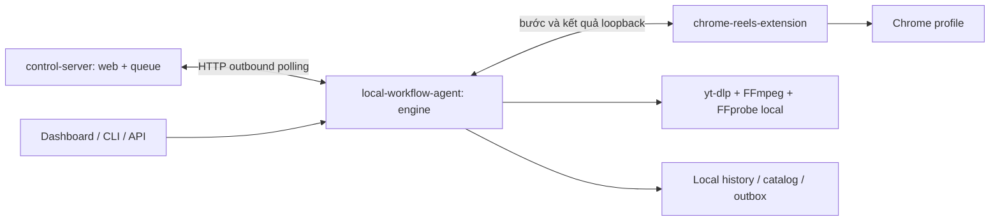

# Ba ứng dụng triển khai độc lập

```text
local-agent-work-flow/
├── local-workflow-agent/       Copy riêng sang máy local
│   ├── index.js, package.json, package-lock.json, .env.example
│   ├── src/                   Workflow, HTTP, storage, integrations
│   ├── dashboard/             UI loopback 127.0.0.1:34719
│   ├── shared/                Protocol HTTP đi kèm local app
│   ├── scenarios/             Mẫu và JSON cấu hình local
│   ├── scripts/               Setup/check/startup/migrate
│   └── docs/                  Setup, API, scenario, storage
├── chrome-reels-extension/     Cài/đóng gói Chrome MV3 riêng
│   ├── manifest.json, background.js, content.js
│   ├── options.html, options.js
│   └── package.ps1            ZIP whitelist
├── control-server/             Copy riêng sang VPS/build Docker
│   ├── index.js, package.json, .env.example
│   ├── src/, web/, shared/
│   ├── scripts/publish-image.ps1
│   └── deploy/                Compose, Docker, proxy, service
├── local-agent.js              Launcher tương thích → local app
├── remote-control.js           Launcher tương thích → server app
├── scripts/                    Wrapper cũ/công cụ dev
├── tests/                      Test chung trong repo
├── docs/, prompts/             Kiến trúc/ngữ cảnh phát triển
└── scenarios/, tools/, data/    Installation cũ nếu chưa migrate
```

Mỗi app chứa toàn bộ source runtime. Không import `shared/` bên ngoài. Hai bản `shared/remote-protocol.js` được test byte-for-byte; khi sửa protocol phải cập nhật cả hai. Đây là hợp đồng truyền tin, không phải import source app bên cạnh.

## Luồng chạy



Engine local điều phối duy nhất. VPS không tải video hoặc thao tác DOM. Extension dùng Chrome Debugger/content script; Playwright chỉ dùng trong test. Không public cổng 34719.

## Tương thích

Không tự move kho runtime đang có thể được process khác ghi. Local nhận path legacy khi launcher gốc và dữ liệu cũ còn tồn tại; standalone dùng `.env`, `scenarios/`, `tools/`, `data/` trong app. Migration chạy sau khi dừng agent. Không mang credential/machine ID sang máy khác.

Control ưu tiên `.env` riêng, fallback `.env.control` cũ; database cũ được dùng nếu còn tồn tại. Env override tiếp tục có ưu tiên.

## Kiểm chứng

`tests/project-layout.js` chạy từng app từ cây tạm độc lập/cwd khác, kiểm tra UI/scenario, legacy data, protocol parity và extension ZIP whitelist. `npm test` kiểm tra thêm remote, storage, video, API và Chrome fixture. Playwright chỉ ở package dev gốc.

Hướng dẫn: [local](../local-workflow-agent/README.md), [extension](../chrome-reels-extension/README.md), [server](../control-server/README.md), [module map](SOURCE_MAP.md).
