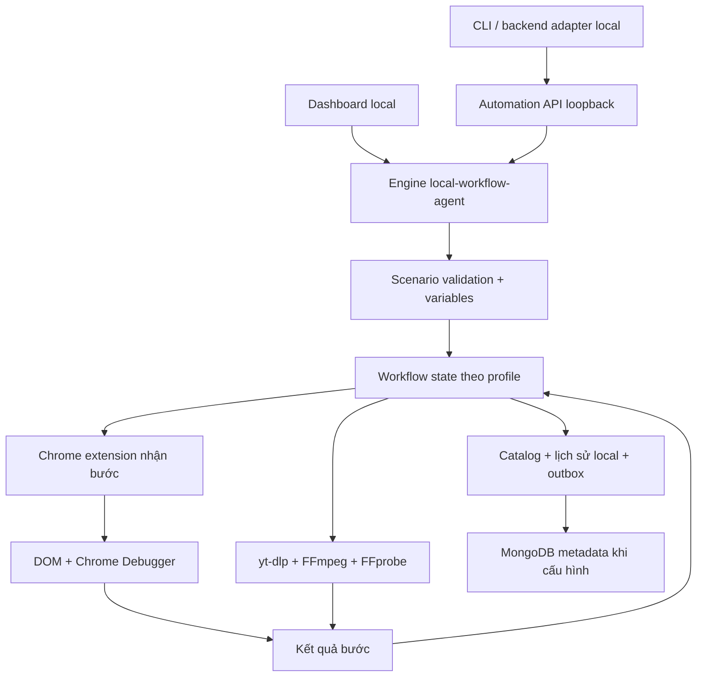

# Bản đồ source và ranh giới tích hợp

Đối chiếu source trong workspace ngày 2026-11-11. Tài liệu phân biệt **cấu trúc hiện tại** với **đề xuất refactor**, chưa di chuyển source hoặc thay đổi cách chạy.

## 1. Các phần chính và công dụng

| Thư mục / điểm vào | Công dụng | Chạy ở đâu / khi nào cần |
| --- | --- | --- |
| `local-workflow-agent/` | Engine thực thi scenario: nhận lệnh, resolve biến, điều phối từng bước theo profile, tải video, gửi thao tác Chrome, lưu kết quả. Có dashboard và API local. | Máy local có media/Chrome. Thành phần trung tâm của workflow. |
| `chrome-reels-extension/` | Cầu nối vào Chrome profile: tìm phần tử, click, nhập, upload file qua Debugger; nhận bước từ engine và trả kết quả. | Cài vào từng Chrome profile. Thư mục dùng Load unpacked hoặc đóng ZIP để chuẩn bị phân phối extension; đóng ZIP không tự publish Chrome Web Store. |
| `local-agent-corebase/` | Agent remote Socket.IO: ghép cặp VPS, quản lý phiên điều khiển terminal, gửi trạng thái thiết bị và chuyển lệnh workflow sang API loopback của engine. | Máy local; chỉ cần khi dùng hệ thống Remote Control Agent bên ngoài. Đây là process riêng, không phải engine workflow. |
| `control-server/` | Server điều khiển workflow từ xa có sẵn trong repo: web đăng nhập, pairing thiết bị, chính sách cấp quyền, hàng đợi lệnh và SQLite. | VPS hoặc máy thử nghiệm. Phối hợp với remote client bên trong engine qua HTTP polling. |
| `shared/` | Helper giao thức remote HTTP: validate, credential, đọc/ghi JSON và HTTP client. | Dùng chung bởi engine và `control-server/`; không phải toàn bộ nghiệp vụ dùng chung của dự án. |
| `scenarios/` | Các kịch bản JSON và biến do người dùng cấu hình. | Đầu vào nghiệp vụ; engine đọc khi chạy. Giữ riêng với source thực thi. |
| `data/` | Machine ID, catalog, lịch sử execution, cache metadata, outbox và trạng thái remote; control server cũng có kho runtime theo cấu hình. | Dữ liệu phát sinh, cần chính sách backup riêng. Không đưa vào Git. |
| `tools/` | Executable yt-dlp, FFmpeg, FFprobe và file tải/giải nén từ script setup. | Máy local tải video. Không phải thư viện JavaScript; cài riêng từng máy. |
| `deploy/` | Docker, Compose, nginx, Traefik và systemd cho control server. | Cấu hình triển khai; không phải nghiệp vụ scenario. |
| `scripts/` | Wrapper setup video/check MongoDB, đóng gói extension, publish image, startup và chạy test bridge. | Công cụ phát triển/vận hành. Một số script chuyển tiếp sang script trong app local. |
| `tests/` | Kiểm thử API, workflow, storage, remote, UI và Chrome fixture riêng. | Môi trường phát triển/CI; Playwright không phải runtime điều khiển Chrome người dùng. |
| `docs/`, `guides.md` | Hướng dẫn setup, kiến trúc, API, lưu trữ và vận hành. | Người phát triển/vận hành. |
| `prompts/` | Bối cảnh, công việc đang làm/hoàn tất và kế hoạch. | Tham khảo quá trình phát triển; không tham gia runtime. |
| `dist/`, `test-results/`, `node_modules/` | Artifact đóng gói, kết quả test và dependency đã cài. | Sinh lại bằng công cụ; không coi là module nghiệp vụ cần tích hợp. |
| `.facebook-chrome-profile/` | Dữ liệu Chrome profile nếu có trong workspace. | Dữ liệu riêng của máy; không chuyển vào source dự án lớn. |
| `local-agent.js` | Launcher tương thích gọi `local-workflow-agent/index.js`. | `node local-agent.js` tiếp tục là lệnh khởi động engine. |
| `remote-control.js` | Launcher tương thích gọi `control-server/index.js`. | `node remote-control.js` khởi động server remote HTTP. |

**Lưu ý tên thư mục:** workspace hiện có `local-agent-corebase/`; Git và một số tài liệu cũ vẫn gọi `local-agent/`. Đây là tên cũ của bridge Socket.IO, không phải file `local-agent.js`. Việc đổi tên đang có trong working tree của người dùng; tài liệu này không tự commit việc đổi tên hoặc dữ liệu credential đi kèm.

## 2. Structure tree hiện tại

Cây dưới đây tập trung vào source quan trọng; bỏ qua dependency, credential, profile và file sinh tự động.

```text
local-agent-work-flow/
├── local-agent.js                    # Launcher engine local
├── remote-control.js                 # Launcher control server HTTP
├── package.json                      # Lệnh dev/test/package ở gốc
├── .env.example                      # Mẫu cấu hình engine
├── .env.control.example              # Mẫu cấu hình control server
├── local-workflow-agent/
│   ├── index.js                      # Nạp env; chọn server/daemon/CLI
│   ├── package.json                  # Dependency runtime local
│   ├── dashboard/
│   │   ├── index.html                # Editor scenario, profile, chạy/dừng
│   │   ├── content.html              # Quản lý nội dung/page
│   │   ├── remote.html               # Cấp quyền/kết nối remote HTTP
│   │   ├── remote.js, remote.css      # Logic/style cấu hình remote local
│   │   └── issues.js                 # Hiển thị vấn đề/chẩn đoán trên UI
│   ├── src/
│   │   ├── main.js                   # Ghép service, HTTP, bridge, terminal
│   │   ├── cli.js                    # Client CLI gọi API automation
│   │   ├── config.js, env.js         # Cấu hình và nạp .env
│   │   ├── paths.js                  # Đường dẫn app/project/data/tools
│   │   ├── workflow/
│   │   │   ├── scenario-store.js     # Đọc/lưu/validate/prepare scenario
│   │   │   ├── variables.js          # Biến cấu hình và runtime references
│   │   │   ├── workflows.js          # State machine, thứ tự, Stop, profile
│   │   │   └── media-guard.js        # Chống trùng, pause/xác nhận, media lock
│   │   ├── http/
│   │   │   ├── automation-api.js     # API /api/v1 cho CLI/backend/bridge
│   │   │   └── content-api.js        # Catalog, page, metadata nội dung
│   │   ├── storage/
│   │   │   ├── activity-store.js     # Kho local, lịch sử, catalog, outbox
│   │   │   ├── download-cache.js     # Tái sử dụng file verified, khóa URL
│   │   │   └── casefold.js           # Chuẩn hóa Unicode cho định danh
│   │   └── integrations/
│   │       ├── chrome/               # Metadata profile và Windows picker
│   │       ├── video/                # Gọi yt-dlp/FFmpeg/FFprobe
│   │       ├── mongo/                # Mongo sync, truy vấn và DNS process
│   │       └── remote/               # Client HTTP polling + executor remote
│   └── scripts/                      # Cài công cụ video, kiểm tra MongoDB
├── chrome-reels-extension/
│   ├── manifest.json                 # MV3, permissions, entry extension
│   ├── background.js                 # Poll engine, tab/navigation, Debugger
│   ├── content.js                    # Locator, action và editor trong DOM
│   └── options.html, options.js      # Chọn/ghi ánh xạ Chrome profile
├── local-agent-corebase/             # Bridge Socket.IO, process độc lập
│   ├── src/index.js                  # Enroll, Socket.IO, lease, handler
│   ├── src/terminal.js               # Quản lý terminal PTY
│   ├── src/status.js                 # Thu thập trạng thái thiết bị
│   ├── src/workflow.js               # Client API loopback + socket adapter
│   ├── src/workflow-cli.js           # Logic CLI workflow của bridge
│   ├── workflow.js                   # Entry CLI bridge
│   ├── scripts/                      # Startup/service mẫu
│   └── test/                         # Unit test bridge/terminal/status
├── control-server/
│   ├── index.js                      # Bootstrap server VPS
│   ├── src/server.js                 # HTTP, đăng nhập, pairing, device API
│   ├── src/commands.js               # Queue, quyền và vòng đời lệnh
│   ├── src/store.js                  # Lưu SQLite
│   ├── src/proxy.js                  # Xác định IP qua trusted proxy
│   ├── src/healthcheck.js            # Kiểm tra service triển khai
│   └── web/                          # UI remote phía server
├── shared/remote-protocol.js          # Hợp đồng/helper remote HTTP
├── scenarios/                        # JSON workflow người dùng
├── deploy/control/                   # Container, proxy, service config
├── scripts/                          # Tooling ở gốc
├── tests/                            # Test tích hợp và fixture
├── docs/, prompts/, guides.md         # Tài liệu và ngữ cảnh phát triển
└── tools/, data/, dist/               # Binary/runtime/artifact, tách khỏi code
```

## 3. Luồng thực thi chuẩn

Engine local là nơi duy nhất điều phối scenario. Dashboard, CLI và remote là các đường đưa lệnh vào engine; extension là executor cho bước trình duyệt.



1. Người dùng hoặc adapter chọn scenario đã lưu, profile và biến đầu vào.
2. Engine validate, resolve biến trên bản sao; không ghi đè JSON gốc khi chạy.
3. Workflow thực hiện bước local (`wait`, `openFolder`, `downloadVideo`) hoặc phát bước trình duyệt cho extension.
4. Extension chủ động poll engine; engine không điều khiển profile đăng nhập bằng Playwright. `background.js` quản lý tab/navigation/input Debugger, `content.js` tìm DOM và thực hiện logic action.
5. Chỉ khi bước thành công workflow mới đi tiếp. File tải phải verified trước khi đưa đường dẫn sang upload; lỗi/Stop chặn bước tiếp theo.
6. Lịch sử và metadata lưu tại local; MongoDB khi cấu hình dùng cho catalog/metadata/sync, không chứa byte video. File media ở thư mục người dùng chọn.

### Hai đường remote đang tồn tại

| Đường remote | Luồng | Trách nhiệm |
| --- | --- | --- |
| HTTP tích hợp trong repo | Web `control-server/` → queue VPS ← polling từ `integrations/remote/` → workflow engine | Pairing, allowlist profile/scenario/biến, journal, chạy/dừng workflow remote. |
| Socket.IO Corebase | Server remote bên ngoài ↔ `local-agent-corebase/` → Bearer API `127.0.0.1:34719/api/v1/*` → workflow engine | Phiên/lease, terminal, trạng thái máy và bridge lệnh workflow. |

`control-server/` không phải server Socket.IO cho Corebase. `shared/remote-protocol.js` thuộc đường HTTP, không mặc nhiên là hợp đồng Socket.IO. Khi tích hợp hệ thống lớn, chọn đường điều khiển chính và giữ quản lý quyền/ownership rõ ràng nếu vẫn bật cả hai; một profile chỉ chạy một scenario tại một thời điểm.

## 4. Điểm tích hợp nên dùng

| Nhu cầu của dự án lớn | Điểm nối hiện có | Giới hạn cần giữ |
| --- | --- | --- |
| Liệt kê profile/scenario, bắt đầu workflow | `/api/v1/profiles`, `/api/v1/scenarios`, `POST /api/v1/runs` | Bearer token local; scenario đã lưu, profile tường minh, validate biến. |
| Theo dõi/dừng tác vụ | `GET /api/v1/runs`, `GET /api/v1/runs/:runId`, `POST /api/v1/runs/:runId/stop` | Dùng ID trả về; không suy đoán lượt đang chạy theo vị trí bước. |
| Gửi lệnh từ VPS | Adapter remote trên local | Backend trình duyệt không gọi thẳng API loopback; API automation từ chối Origin và chỉ dành cho CLI/server client. |
| Tích hợp thư viện nội dung dùng chung | `content-api.js`, `mongo-sync.js`, hợp đồng UUID/catalog | Giữ ID, quy tắc conflict và outbox; không thay bằng copy video vào MongoDB. |
| Thêm action scenario | Validate/prepare + workflows + executor local hoặc extension + dashboard + docs/test | Giữ action/selector cũ; xác định điều kiện hoàn tất, timeout và Stop. |

API loopback là ranh giới tích hợp **đang có**, chưa phải SDK thư viện tách độc lập. Không nên import `main.js` vào backend lớn: file này có side effect khởi động server, timer và terminal. Không mở public cổng `34719`; để adapter local nhận lệnh qua kết nối outbound. Chi tiết request, token và idempotency tại [AUTOMATION_API.md](AUTOMATION_API.md).

## 5. Cấu trúc đích đề xuất khi refactor

Đây là **đề xuất**, chưa phải source hiện tại. Có thể áp dụng dần trong monorepo của dự án lớn:

```text
apps/
├── local-agent/                 # Host process, config, HTTP, dashboard
├── chrome-extension/            # Build/release MV3 độc lập
├── control-server/              # Nếu giữ đường remote HTTP hiện có
└── remote-terminal-agent/       # Nếu giữ Corebase Socket.IO
packages/
├── workflow-core/              # Scenario, biến, state machine; inject executor
├── workflow-contracts/         # Schema/version action, command, result, API DTO
├── local-storage/              # Repository local, lịch sử, cache, outbox
└── integrations/
    ├── chrome/                 # Adapter profile/bridge, không dùng DOM Node
    ├── video/                  # Process yt-dlp/FFmpeg/FFprobe
    ├── content-catalog/        # MongoDB và mapping metadata
    └── remote/                 # HTTP/Socket.IO adapters, tách từng protocol
configs/                        # File mẫu, không credential
deploy/                         # Deployment từng app
tests/                          # Contract/integration/end-to-end
docs/                           # API và vận hành
```

Hướng phụ thuộc đề xuất: `apps → adapters/storage → workflow-core + contracts`. Core nhận dependency qua interface/hàm được inject, không import HTTP server, MongoDB, Chrome API hoặc Socket.IO. Extension chỉ dùng contract phù hợp trình duyệt, không import Node builtins từ `shared/` hiện tại.

## 6. Thứ tự refactor đề nghị

1. **Chốt ranh giới sản phẩm:** giữ remote HTTP, Corebase hay cả hai; quy định bên sở hữu account, thiết bị, lease và command ID. Chốt tên `local-agent-corebase` để xử lý chỗ tài liệu/Git còn dùng tên cũ.
2. **Chốt contract:** schema scenario/version, action, kết quả, runtime variables, profile ID, run/execution/command ID và lỗi. Giữ đọc được `selector` CSS cũ; không gộp các ID có vòng đời khác nhau chỉ vì đều là UUID.
3. **Tách host khỏi nghiệp vụ:** giảm `main.js` thành composition root; đưa routing, static assets, auth, terminal và lifecycle sang module riêng. `workflows.js` hiện đã nhận nhiều dependency qua constructor, có thể dùng làm điểm bắt đầu.
4. **Tách adapter:** giữ video, Chrome, MongoDB, remote sau interface; thao tác file/binary vẫn ở máy local. Đưa CSS/JS inline của dashboard ra asset riêng nếu cần UI tích hợp.
5. **Tách đường dẫn cấu hình:** hiện `paths.js` và script setup phụ thuộc layout repo; chuyển sang cấu hình app/data/scenario/tools rõ ràng trước khi di chuyển thư mục. Giữ wrapper `node local-agent.js`, URL `127.0.0.1:34719` và đường dẫn extension/scenario tương thích trong giai đoạn chuyển tiếp.
6. **Tách dữ liệu và release:** backup runtime/credential bằng cơ chế riêng; build extension, agent và VPS thành artifact riêng. Cập nhật cả lockfile gốc và local khi dependency runtime thay đổi.
7. **Kiểm thử trước chuyển đổi:** contract, thứ tự/Stop/profile isolation, cache theo ngôn ngữ/độ phân giải, navigation, editor động, lease/idempotency và khôi phục sau restart. Dùng Chrome fixture riêng; không dùng profile đăng nhập để test tự động.

## 7. Thứ tự đọc source

Đọc `local-agent.js` → `local-workflow-agent/index.js` → `src/main.js` để thấy bootstrap. Sau đó đọc `workflow/scenario-store.js`, `variables.js`, `workflows.js`; đối chiếu `chrome-reels-extension/background.js` và `content.js` cho bước trình duyệt, `integrations/video/video-download.js` cho bước tải. Tiếp theo đọc `storage/`, `http/automation-api.js`, rồi mới đọc adapter remote bạn chọn sử dụng.

Tài liệu liên quan: [kiến trúc triển khai](ARCHITECTURE.md), [setup từng bước](SETUP.md), [schema scenario](SCENARIOS.md), [lưu trữ](ACTIVITY_STORAGE.md), [MongoDB](MONGODB_ATLAS.md), [remote HTTP](REMOTE_CONTROL.md).
